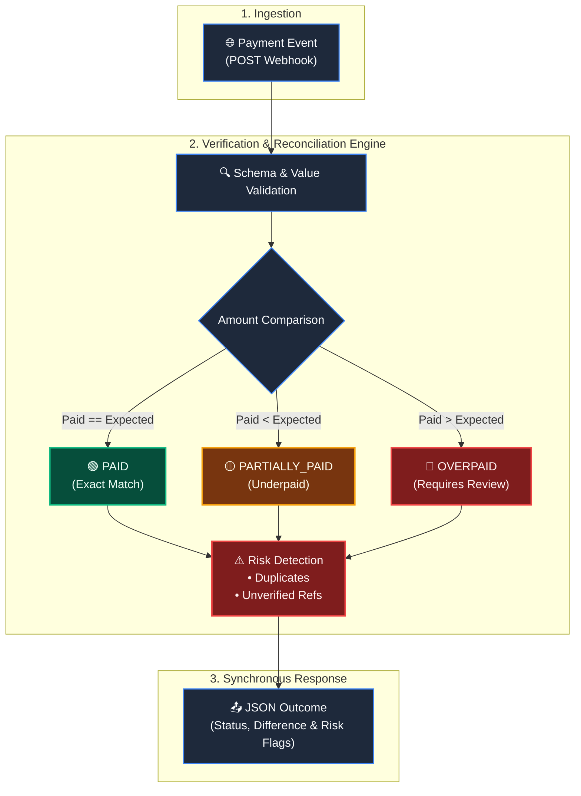

# ⚡ Invoice & Payment Monitoring Automation

<p align="center">
  
  
  
  
</p>

<p align="center">
  A lightweight, real-time n8n automation workflow that validates incoming payment transactions, reconciles amounts against invoices, and flags anomalies before downstream settlement.
</p>

---

## 🏗️ Architecture & Flow

The workflow operates as an event-driven microservice listening to payment gateway events and returning immediate verification results.



---

## 🔄 How the Flow Works

| Step | Stage | What Happens |
| :---: | :--- | :--- |
| **1** | **Ingest** | Listens for POST events from payment providers via `/portfolio-payment-monitor`. |
| **2** | **Validate** | Ensures required fields (`invoiceId`, `paymentId`, amounts) are present and structurally valid. |
| **3** | **Reconcile** | Compares `expectedAmount` vs `paidAmount` to evaluate financial accuracy. |
| **4** | **Flag Risks** | Inspects flags for upstream duplicate markers, unverified references, or amount discrepancies. |
| **5** | **Respond** | Returns instant reconciliation verdict and marks if manual finance review is required. |

---

## 📊 Status Matrix

| Status | Trigger Condition | Manual Review? |
| :--- | :--- | :---: |
| `PAID` | Amount matches invoice balance | ❌ No |
| `PARTIALLY_PAID` | Paid amount is less than invoice total | ⚠️ Yes |
| `OVERPAID` | Paid amount exceeds invoice total | ⚠️ Yes |
| `UNPAID` | Payment amount is 0 | ❌ No |
| `INVALID_DATA` | Missing or negative amount values | ⚠️ Yes |

---

## ⚡ Quick Start

1. **Import Workflow:** Open **n8n** ➜ Click **Add Workflow** ➜ Select **Import from File** ➜ Choose [`Invoice_Payment_Monitoring.json`](./Invoice_Payment_Monitoring.json).
2. **Activate:** Toggle workflow status to **Active** to obtain your production webhook URL.
3. **Send Payload:** Point your payment gateway or webhook dispatcher to the generated URL:

```json
{
  "invoiceId": "INV-1001",
  "paymentId": "PAY-5001",
  "expectedAmount": 1500.00,
  "paidAmount": 1500.00,
  "currency": "USD"
}
```

---

## 📄 License

Distributed under the MIT License.
