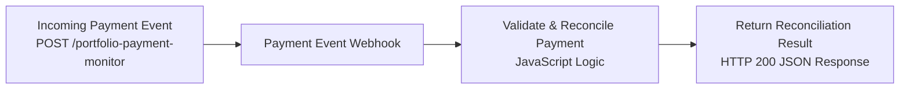

# Invoice & Payment Monitoring Automation (n8n)

An automated n8n workflow designed to validate, monitor, and reconcile invoice payment events in real time. It catches discrepancies, partial payments, overpayments, duplicate transactions, and unverified payment references.

---

## 📌 Overview

Timely and accurate payment reconciliation is critical for financial operations. This n8n workflow receives incoming payment event notifications via a webhook, validates input data integrity, compares expected versus received amounts, detects risk indicators, and responds immediately with a structured reconciliation payload.

---

## 🚀 Workflow Architecture



### Workflow Nodes

| Node Name | Node Type | Purpose |
| :--- | :--- | :--- |
| **Payment Event Webhook** | `n8n-nodes-base.webhook` | Listens for incoming HTTP POST requests at `/portfolio-payment-monitor`. |
| **Validate & Reconcile Payment** | `n8n-nodes-base.code` | Validates input parameters, determines payment status, checks risk indicators, and flags items requiring manual review. |
| **Return Reconciliation Result** | `n8n-nodes-base.respondToWebhook` | Returns the structured reconciliation JSON response back to the caller. |

---

## 📥 API & Webhook Specification

### Endpoint Details
- **Method:** `POST`
- **Path:** `/webhook/portfolio-payment-monitor` (Production) or `/webhook-test/portfolio-payment-monitor` (Test)
- **Response Mode:** Using Response Node (`200 OK`)

### Request Body (JSON)

| Field | Type | Required | Description |
| :--- | :--- | :--- | :--- |
| `invoiceId` | `string` | **Yes** | Identifier of the invoice. |
| `paymentId` | `string` | **Yes** | Unique identifier of the payment transaction. |
| `expectedAmount` | `number` | **Yes** | Total invoice amount expected (must be $\ge 0$). |
| `paidAmount` | `number` | **Yes** | Actual amount paid by the customer (must be $\ge 0$). |
| `currency` | `string` | No | Currency code (e.g., `USD`, `EUR`, `PKR`). Defaults to `USD`. |
| `duplicate` | `boolean` | No | Set to `true` if flagged as duplicate by upstream payment gateway. |
| `referenceVerified` | `boolean` | No | Set to `false` if transaction reference failed verification. |

#### Example Request
```json
{
  "invoiceId": "INV-2026-0042",
  "paymentId": "PAY-88912",
  "expectedAmount": 1500.00,
  "paidAmount": 1500.00,
  "currency": "USD",
  "duplicate": false,
  "referenceVerified": true
}
```

---

## 📤 Reconciliation Responses

### 1. Successful Reconciliation (`PAID`)
```json
{
  "success": true,
  "workflow": "Invoice & Payment Monitoring",
  "reconciliation": {
    "invoiceId": "INV-2026-0042",
    "paymentId": "PAY-88912",
    "currency": "USD",
    "expectedAmount": 1500,
    "paidAmount": 1500,
    "difference": 0,
    "status": "PAID",
    "riskFlags": [],
    "requiresManualReview": false
  },
  "processedAt": "2026-11-17T18:30:00.000Z",
  "note": "Starter reconciliation logic. Production duplicate detection requires checking paymentId against a persistent database or accounting system."
}
```

### 2. Discrepancy / Partial Payment (`PARTIALLY_PAID`)
```json
{
  "success": true,
  "workflow": "Invoice & Payment Monitoring",
  "reconciliation": {
    "invoiceId": "INV-2026-0043",
    "paymentId": "PAY-88913",
    "currency": "USD",
    "expectedAmount": 2000,
    "paidAmount": 1200,
    "difference": 800,
    "status": "PARTIALLY_PAID",
    "riskFlags": [
      "Paid amount does not match invoice total"
    ],
    "requiresManualReview": true
  },
  "processedAt": "2026-11-17T18:30:00.000Z",
  "note": "Starter reconciliation logic. Production duplicate detection requires checking paymentId against a persistent database or accounting system."
}
```

### 3. Invalid Data Submission
```json
{
  "success": false,
  "workflow": "Invoice & Payment Monitoring",
  "status": "INVALID_DATA",
  "message": "Provide invoiceId, paymentId, expectedAmount and paidAmount as valid values."
}
```

---

## ⚙️ Reconciliation Logic & Statuses

| Status | Condition | Description |
| :--- | :--- | :--- |
| `UNPAID` | `paidAmount === 0` | No payment received yet. |
| `PAID` | `\|expectedAmount - paidAmount\| < 0.01` | Fully settled. |
| `PARTIALLY_PAID` | `paidAmount < expectedAmount` | Underpaid; balance remains. |
| `OVERPAID` | `paidAmount > expectedAmount` | Overpayment detected; triggers manual review. |

### Risk Flags & Manual Review Triggers
Manual review (`requiresManualReview: true`) is triggered when any risk flag exists or when the status is `OVERPAID`:
- **Duplicate Payment**: Flagged when `duplicate === true`.
- **Amount Mismatch**: Flagged when paid amount does not match expected invoice total.
- **Unverified Reference**: Flagged when `referenceVerified === false`.

---

## 📦 How to Import into n8n

1. **Clone or Download:**
   - Clone this repository or copy the contents of [`Invoice_Payment_Monitoring.json`](./Invoice_Payment_Monitoring.json).
2. **Open n8n:**
   - Go to your n8n workspace.
   - Click **Add Workflow** -> **Import from File** (or paste the JSON directly into the canvas using `Ctrl + V`).
3. **Activate Webhook:**
   - Toggle the workflow from **Inactive** to **Active** to listen on the production webhook URL.
4. **Test the Endpoint:**
   - Use Postman, cURL, or any HTTP client to send test payloads to the webhook URL.

```bash
curl -X POST "https://<your-n8n-instance>/webhook-test/portfolio-payment-monitor" \
     -H "Content-Type: application/json" \
     -d '{
       "invoiceId": "INV-1001",
       "paymentId": "PAY-5001",
       "expectedAmount": 250.00,
       "paidAmount": 250.00,
       "currency": "USD"
     }'
```

---

## 🔮 Production Recommendations

To upgrade this starter workflow for enterprise production:
- **Database Idempotency Check**: Connect a PostgreSQL, MySQL, or MongoDB node to verify whether `paymentId` has already been processed to prevent replay attacks and duplicate payments.
- **Accounting System Integration**: Integrate with QuickBooks, Xero, Stripe, or NetSuite nodes to mark invoices paid automatically.
- **Automated Alerts**: Connect Slack, Discord, or Email nodes to notify the finance team when `requiresManualReview` is `true`.

---

## 📄 License

This project is licensed under the MIT License.
